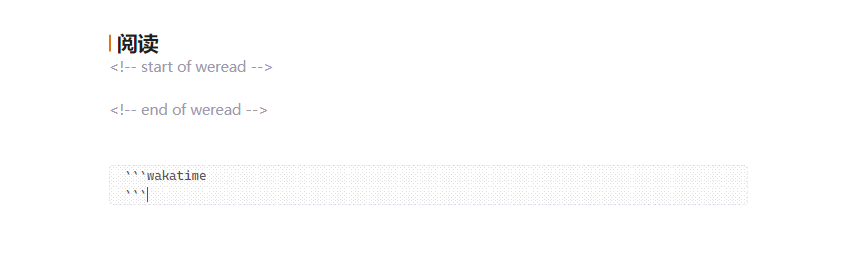
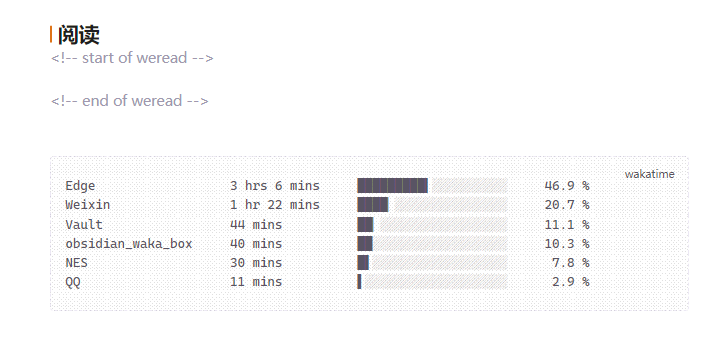

# WakaTime Box for LifeOS

[中文说明 →](./README.zh-CN.md)

Writes your [WakaTime](https://wakatime.com/) stats into your [LifeOS](https://github.com/quanru/obsidian-lifeos) daily note — automatically.

## Usage

1. Put an empty `wakatime` code block into your LifeOS daily note template:

2. That's all. Whenever LifeOS creates a daily note, the box is filled and kept up to date (on note creation, once per hour, or on demand):

## Requirements

- Obsidian 1.13.0 or newer (older Obsidian versions keep the last compatible release automatically)
- [LifeOS](https://github.com/quanru/obsidian-lifeos) enabled, with **Periodic Notes** turned on (the plugin reads LifeOS settings to find the daily note, and never creates notes itself)
- A [WakaTime](https://wakatime.com/) account; paste your [API key](https://wakatime.com/api-key) into the plugin settings

## Install

- **Obsidian community plugins (once published):** Settings → Community plugins → search for *WakaTime Box for LifeOS* → Install; updates then come from the GitHub releases automatically.
- **BRAT (before publication / beta channel):** add `Luke-Evan/obsidian-wakatime-box-lifeos` in the BRAT settings, then enable *WakaTime Box for LifeOS*. BRAT installs and updates the plugin straight from the GitHub releases.
- **Manual:** download `main.js` and `manifest.json` from the [latest release](https://github.com/Luke-Evan/obsidian-wakatime-box-lifeos/releases/latest) into `<vault>/.obsidian/plugins/wakatime-box-lifeos/`, then enable the plugin.

## Settings & commands

- **Display data:** projects, languages, editors or categories — the six biggest entries of the day.
- **Sync now:** buttons for today and yesterday; the same actions exist as commands, so you can bind hotkeys to them in Settings → Hotkeys (search for *WakaTime*).
- **Copy the stats of any date to the clipboard** command, for weekly notes or reports.

## Credits & license

Fork of [simonla/obsidian_waka_box](https://github.com/simonla/obsidian_waka_box) (MIT); the daily note layout follows [LifeOS](https://github.com/quanru/obsidian-lifeos). Licensed under [MIT](./LICENSE).
