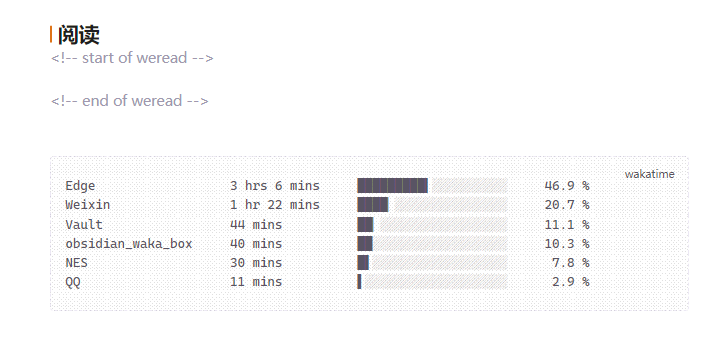

# WakaTime Box for LifeOS

[English →](./README.md)

把你的 [WakaTime](https://wakatime.com/) 统计自动写进 [LifeOS](https://github.com/quanru/obsidian-lifeos) 的日记里。

## 使用

1. 在 LifeOS 的日记模板中放一个空的 `wakatime` 代码块：

2. 之后无需任何操作：LifeOS 每次创建日记时，统计块会自动填入并保持更新（创建时、每小时、或手动触发）：

## 依赖

- Obsidian 1.1.7 及以上
- 已启用 [LifeOS](https://github.com/quanru/obsidian-lifeos) 并打开 **Periodic Notes**（插件读取 LifeOS 设置定位日记，自己不会创建笔记）
- 一个 [WakaTime](https://wakatime.com/) 账号；在插件设置中填入 [API key](https://wakatime.com/api-key)

## 安装

- **Obsidian 社区插件目录（收录后）：** 设置 → 第三方插件 → 搜索 *WakaTime Box for LifeOS* → 安装；之后更新自动来自 GitHub Release。
- **BRAT（收录前 / beta 渠道）：** 在 BRAT 设置中添加 `Luke-Evan/obsidian-wakatime-box-lifeos`，然后启用 *WakaTime Box for LifeOS*；BRAT 会直接从 GitHub Release 安装并更新插件。
- **手动：** 从 [最新 Release](https://github.com/Luke-Evan/obsidian-wakatime-box-lifeos/releases/latest) 下载 `main.js` 和 `manifest.json`，放入 `<vault>/.obsidian/plugins/wakatime-box-lifeos/`，然后启用插件。

## 设置与命令

- **Display data：** 项目 / 语言 / 编辑器 / 类别，展示当天耗时最多的 6 条。
- **Sync now：** 今天 / 昨天两个立即同步按钮；同样的动作也是命令，可在「设置 → 快捷键」中绑定（搜索 *WakaTime*）。
- **Copy the stats of any date to the clipboard** 命令：把任意一天的统计块复制到剪贴板，方便写周报。

## 致谢与许可证

Fork 自 [simonla/obsidian_waka_box](https://github.com/simonla/obsidian_waka_box)（MIT）；日记路径规则遵循 [LifeOS](https://github.com/quanru/obsidian-lifeos)。许可证：[MIT](./LICENSE)。
